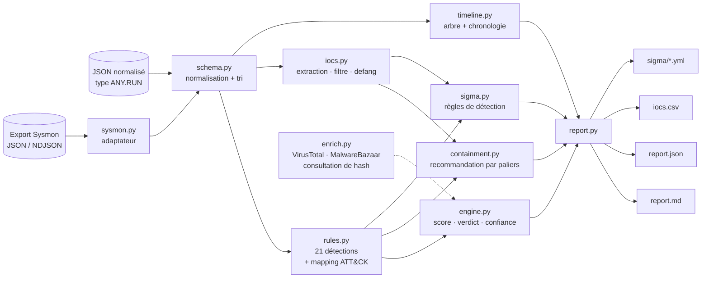

<div align="center">

# 🧪 SandboxScribe

**Transformer la télémétrie brute d'un sandbox en rapport malware de niveau SOC**
*Arbre de processus · Chronologie des comportements · MITRE ATT&CK · IOC · Règles Sigma · Recommandation de confinement*

> *Le rapport est le livrable. Le sandbox n'est que l'outil.*

[🇬🇧 English](README.md) · 🇫🇷 Français


[](https://github.com/NikoRNK/sandboxscribe/actions)

</div>

---

## Sommaire

1. [Pourquoi ce projet](#pourquoi-ce-projet)
2. [De la détonation au livrable](#de-la-détonation-au-livrable)
3. [Fonctionnalités](#fonctionnalités)
4. [Architecture](#architecture)
5. [Démarrage rapide](#démarrage-rapide)
6. [Utilisation](#utilisation)
7. [Formats d'entrée](#formats-dentrée)
8. [Exemple de sortie](#exemple-de-sortie)
9. [Règles de détection et score](#règles-de-détection-et-score)
10. [Couverture MITRE ATT&CK](#couverture-mitre-attck)
11. [Génération de règles Sigma](#génération-de-règles-sigma)
12. [Utilisation comme bibliothèque](#utilisation-comme-bibliothèque)
13. [Détoner en sécurité](#détoner-en-sécurité)
14. [Structure du projet](#structure-du-projet)
15. [Tests](#tests)
16. [Choix de conception et limites](#choix-de-conception-et-limites)
17. [Feuille de route](#feuille-de-route)
18. [Usage responsable](#usage-responsable)
19. [Auteur](#auteur) · [Licence](#licence)

---

## Pourquoi ce projet

Tout SOC reçoit des pièces jointes suspectes. Les détoner dans un sandbox est la
partie facile. Ce qui distingue un analyste d'un simple presse-bouton, c'est la
**rédaction du rapport** : une chronologie claire des comportements, les
indicateurs que la blue team peut bloquer, et une recommandation de confinement
qu'un responsable peut valider en deux minutes.

**SandboxScribe automatise cette rédaction.** Il lit la télémétrie d'une
détonation (outils de type ANY.RUN, ou VM isolée avec Sysmon) et produit :

* un **verdict** avec un niveau de confiance, justifié règle par règle,
* un **arbre de processus** et une **chronologie des comportements** lisibles,
* chaque comportement rattaché à **MITRE ATT&CK**,
* des **IOC « defangés »** (hashes, domaines, IP, URL, mutex, clés de persistance, fichiers déposés), bruit système filtré,
* des **règles de détection Sigma** générées à partir de ce que l'échantillon a réellement fait,
* une **recommandation de confinement par paliers** déduite du comportement observé.

> **SandboxScribe n'exécute, n'ouvre et ne télécharge jamais d'échantillon.** Il
> analyse uniquement une télémétrie déjà collectée. Ce dépôt ne contient aucun malware.

## De la détonation au livrable

| Étape | Ce que fait un bon analyste | Où ça se passe |
|-------|-----------------------------|----------------|
| **Détoner en sécurité** | Prendre un échantillon de recherche (ex. MalwareBazaar) | Vous, en labo — voir [`docs/SAFE_LAB.md`](docs/SAFE_LAB.md) |
| | Le lancer dans ANY.RUN ou une **VM isolée uniquement** | Vous (sandbox hébergé ou VM restaurée depuis un snapshot) |
| | Observer **processus, fichiers, réseau** | Sandbox / Sysmon produisent la télémétrie |
| **Rédiger le rapport** | **Chronologie des comportements** | `timeline.py` — arbre de processus + événements chronologiques |
| | **IOC, hashes, domaines, IP** | `iocs.py` — dédupliqués, defangés, bruit filtré |
| | **Une recommandation de confinement** | `containment.py` — par paliers, propre à ce qui a été observé |
| *(bonus)* | S'assurer de le détecter la prochaine fois | `sigma.py` — règles Sigma |

## Fonctionnalités

- 🧬 **21 détections comportementales explicables** rattachées à 23 techniques ATT&CK : chaîne Office→shell, PowerShell encodé, téléchargement de payload, persistance (clé Run / tâche planifiée / service), sabotage de Defender, injection de processus, accès à LSASS, vol d'identifiants navigateur, suppression des clichés instantanés, chiffrement de masse, balisage C2 (analyse de l'intervalle et de la gigue), domaines type DGA, gros envois, auto-suppression, délais anti-sandbox…
- 🌳 **Arbre de processus** reconstruit à partir de `pid`/`ppid`
- 🕒 **Chronologie des comportements** — chaque événement à l'origine d'une détection est toujours affiché
- 🎯 **Extraction d'IOC** avec filtrage du bruit OS/éditeur (Windows Update, vérifications de certificats…) et defanging
- 🛡️ **Recommandation de confinement** en quatre paliers : *Immédiat · Éradiquer · Chasser · Récupérer et communiquer* — chaque ligne n'existe que si le comportement correspondant a été observé
- 📜 **Générateur de règles Sigma** (création de processus, DNS, réseau, registre, fichiers)
- 🔌 **Adaptateur Sysmon** — tableau JSON ou NDJSON, détecté automatiquement
- 🌐 **Threat intel optionnelle sur hash** — VirusTotal v3 et MalwareBazaar (consultation seule, cache, aucun envoi)
- 🧾 **Sorties** — rapport Markdown, JSON, CSV d'IOC, YAML Sigma
- 🧱 **Zéro dépendance** — bibliothèque standard uniquement
- 🤖 **Compatible SOAR** — code de sortie `2` si `MALICIOUS`

## Architecture



## Démarrage rapide

```bash
git clone https://github.com/NikoRNK/sandboxscribe.git
cd sandboxscribe
pip install -e .          # aucune dépendance à l'exécution

sandboxscribe report samples/invoice_dropper_report.json \
    --no-intel --out report.md --iocs iocs.csv --sigma-dir sigma/
```

Nécessite **Python 3.9+**. Fonctionne sous Linux, macOS et Windows.

## Utilisation

```text
sandboxscribe report <entrée> [--out report.md] [--json result.json] [--iocs iocs.csv]
                              [--sigma-dir DIR] [--author NOM] [--no-intel]
                              [--vt-key CLE] [--mb-key CLE] [--cache DIR]
                              [--sample-name NOM] [--sample-sha256 SHA]
sandboxscribe tree   <entrée>
sandboxscribe --version
```

| Option | Description |
|--------|-------------|
| `--out / --json / --iocs` | Rapport Markdown, résultat JSON complet, CSV d'IOC |
| `--sigma-dir DIR` | Écrit les règles Sigma générées dans ce dossier |
| `--author NOM` | Champ `author:` des règles Sigma (défaut `SandboxScribe`) |
| `--no-intel` | Ne jamais contacter VirusTotal / MalwareBazaar |
| `--vt-key` / `--mb-key` | Clés API ; par défaut `$VT_API_KEY` / `$MB_AUTH_KEY` |
| `--sample-name/--sample-sha256` | Identifie l'échantillon quand l'entrée est un export Sysmon |

**Codes de sortie :** `0` = suspect / propre · `2` = malveillant · `1` = erreur.

```bash
# Rapport normalisé natif (export de type ANY.RUN converti, ou écrit à la main)
sandboxscribe report detonation.json --out report.md

# VM isolée + export Sysmon (détecté automatiquement)
sandboxscribe report sysmon.ndjson --sample-name dropper.js --sample-sha256 <sha256> \
    --out report.md --sigma-dir sigma/

# Uniquement l'arbre de processus
sandboxscribe tree detonation.json

# Avec threat intel sur hash
export VT_API_KEY=… MB_AUTH_KEY=…
sandboxscribe report detonation.json --out report.md
```

## Formats d'entrée

1. **JSON normalisé** — un schéma petit et documenté auquel tout sandbox peut être
   ramené (14 types d'événements). Référence : [`docs/SCHEMA.md`](docs/SCHEMA.md).
2. **Export Sysmon** — événements 1, 3, 8, 10, 11, 13, 22, 23, en tableau JSON ou
   NDJSON, convertis automatiquement. La commande PowerShell d'export est dans
   [`docs/SAFE_LAB.md`](docs/SAFE_LAB.md).

## Exemple de sortie

Tous les chiffres ci-dessous viennent de l'échantillon **synthétique** fourni (un
document à macro fictif qui dépose un faux `svchost32.exe` ; aucun vrai malware) :

```text
$ sandboxscribe report samples/invoice_dropper_report.json --no-intel --out report.md --sigma-dir sigma/
[MALICIOUS] score=100/100 confidence=HIGH detections=15 iocs=12 sigma_rules=5
```

**Arbre de processus**

```text
winword.exe (pid 4120)  "WINWORD.EXE" "C:\Users\analyst\Desktop\Invoice_2025-10.docm"
└─ cmd.exe (pid 5208)  cmd.exe /c powershell -nop -w hidden -enc VwByAGkAdABl…
   └─ powershell.exe (pid 5320)  powershell -nop -w hidden -enc VwByAGkAdABl…
      └─ svchost32.exe (pid 5600)  C:\Users\analyst\AppData\Roaming\Microsoft\Windows\svchost32.exe
         ├─ powershell.exe (pid 5730)  powershell -c Add-MpPreference -ExclusionPath …
         ├─ schtasks.exe (pid 5710)  schtasks /create /tn "WinUpdHelper" /tr "…svchost32.exe" /sc onlogon
         ├─ whoami.exe · systeminfo.exe · ipconfig.exe
         └─ cmd.exe (pid 5800)  cmd.exe /c ping -n 30 127.0.0.1 > nul & del "…Invoice_2025-10.docm"
```

**Ce que fait l'échantillon** (principaux constats, ordre chronologique) — le rapport lui-même est en anglais :

> 2. **Persistence** — clé Run : `…\CurrentVersion\Run [WindowsUpdateHelper] = …\svchost32.exe`
> 3. **Defense Evasion** — outil de sécurité désactivé ou exclu : `Add-MpPreference -ExclusionPath …`
> 4. **Defense Evasion** — code injecté dans un autre processus : `pid 5600 -> explorer.exe`
> 5. **Persistence** — tâche planifiée créée
> 6. **Credential Access** — base d'identifiants du navigateur lue par un processus non-navigateur
> 7. **Command and Control** — rappels réguliers vers un même hôte : `203.0.113.45 : 6 requêtes, toutes les ~27 s (gigue 23 %)`

**Recommandation de confinement** (extrait — remarquez la précision) :

> **Éradiquer :** supprimer la persistance registre `HKCU\…\Run` valeur `WindowsUpdateHelper` (pointe vers `…\svchost32.exe`) ·
> supprimer la ou les tâches planifiées créées · supprimer le fichier déposé `…\svchost32.exe` (sha256 `9a496227eda4…`) ·
> retirer les exclusions Defender ajoutées · faire une image mémoire de l'hôte injecté avant redémarrage.

**IOC defangés** (le bruit système comme `settings-win.data.microsoft.com` est filtré) :

| Type | Valeur |
|---|---|
| sha256 | `2ff95d39ccb5…` (échantillon) · `9a496227eda4…` (`svchost32.exe` déposé) |
| domaine | `update-cdn-7x2k9qv4mz[.]example` |
| ip | `203[.]0[.]113[.]45` |
| url | `hxxp://update-cdn-7x2k9qv4mz[.]example/stage2[.]bin` |
| mutex | `Global\SynthMutex-7Q2K` |
| registre | `HKCU\…\Run [WindowsUpdateHelper]` |

Sorties complètes dans [`examples/`](examples/) :
[`report_invoice_dropper.md`](examples/report_invoice_dropper.md) ·
[`report_invoice_dropper.json`](examples/report_invoice_dropper.json) ·
[`iocs_invoice_dropper.csv`](examples/iocs_invoice_dropper.csv) ·
[`sigma/`](examples/sigma/) ·
[`report_benign_installer.md`](examples/report_benign_installer.md) (le cas propre) ·
[`report_sysmon_script_dropper.md`](examples/report_sysmon_script_dropper.md) (entrée Sysmon).

## Règles de détection et score

Score = somme des poids, plafonnée à 100. Chaque détection conserve les **événements exacts** qui l'ont déclenchée.

| Tactique | Règle | Poids | ATT&CK |
|----------|-------|:-----:|--------|
| Execution | Une application Office lance un interpréteur de commandes | 25 | T1204.002 |
| | PowerShell avec options furtives (`-nop`, fenêtre cachée, bypass) | 15 | T1059.001 |
| | Téléchargement de payload (`DownloadString`, `certutil -urlcache`, BITS…) | 20 | T1105 |
| Persistence | Clé Run / dossier Démarrage | 25 | T1547.001 |
| | Tâche planifiée | 20 | T1053.005 |
| | Service Windows | 20 | T1543.003 |
| Defense evasion | PowerShell encodé | 10 | T1027 |
| | Exécution par binaire système détourné (`mshta`, `regsvr32`, `rundll32`) | 15 | T1218 |
| | Defender désactivé / exclusions | 25 | T1562.001 |
| | Injection de processus | 25 | T1055 |
| | Auto-suppression de l'échantillon | 10 | T1070.004 |
| | Évasion par délai (`ping -n 30`, `timeout /t`) | 10 | T1497.003 |
| Credential access | Accès à LSASS / `comsvcs MiniDump` | 35 | T1003.001 |
| | Base d'identifiants navigateur lue par un non-navigateur | 30 | T1555.003 |
| Discovery | Grappe `whoami` / `systeminfo` / `ipconfig /all` | 10 | T1033 / T1082 / T1016 |
| C2 | Balisage périodique (intervalle moyen, gigue ≤ 35 %) | 25 | T1071.001 |
| | Domaine à forte entropie type DGA | 15 | T1568.002 |
| | Port sortant inhabituel | 10 | T1571 |
| Exfiltration | Gros POST HTTP (≥ 100 ko) | 20 | T1041 |
| Impact | Clichés instantanés / sauvegardes détruits | 35 | T1490 |
| | ≥ 20 fichiers renommés vers une même nouvelle extension | 40 | T1486 |

| Score | Verdict |
|-------|---------|
| ≥ 60, ou confirmé par l'intel (≥ 10 moteurs VT / signature MalwareBazaar) | 🔴 `MALICIOUS` |
| 25 – 59 | 🟠 `SUSPICIOUS` |
| < 25 | 🟢 `NO MALICIOUS BEHAVIOUR OBSERVED` |

Le verdict propre n'est volontairement **pas** « bénin » : un sandbox ne rapporte que
ce qu'il a vu, et un échantillon évasif peut rester silencieux. Le rapport le précise.

## Couverture MITRE ATT&CK

23 techniques sur 8 tactiques (Execution, Persistence, Defense Evasion, Credential
Access, Discovery, Command and Control, Exfiltration, Impact). Le rapport affiche
une bande « kill chain » indiquant les tactiques observées.

## Génération de règles Sigma

Une détonation devient des détections durables. Exemple généré depuis l'échantillon :

```yaml
title: Registry Persistence Value Set by Analysed Sample
id: 28116603-be8c-54c4-a07a-3a27ad6b4920
status: experimental
description: Autostart registry value created during detonation.
author: SandboxScribe
tags:
    - attack.persistence
    - attack.t1547.001
logsource:
    category: registry_set
    product: windows
detection:
    selection:
        TargetObject|endswith:
            - '\Run\WindowsUpdateHelper'
    condition: selection
level: high
```

Règles produites quand le comportement existe : **Office→shell**, **DNS vers C2**,
**réseau vers IP C2**, **persistance registre**, **exécutable déposé**. Ce sont des
points de départ étroits, construits sur les valeurs observées : à généraliser et à
tester sur l'historique avant toute mise en production.

## Utilisation comme bibliothèque

```python
from sandboxscribe.schema import load_report
from sandboxscribe.engine import analyze
from sandboxscribe.report import render_markdown

result = analyze(load_report("detonation.json"))
print(result["verdict"], result["score"], result["confidence"])
for d in result["detections"]:
    print(d["tactic"], d["technique"], d["title"])
open("report.md", "w").write(render_markdown(result))
```

## Détoner en sécurité

Lire [`docs/SAFE_LAB.md`](docs/SAFE_LAB.md) (en anglais) : checklist de VM isolée
(snapshot, pas de dossiers partagés, réseau host-only avec faux internet), conseils
pour les sandbox hébergés, la commande PowerShell d'export Sysmon en JSON, et la
règle qui compte le plus : **ne jamais pousser de malware sur un dépôt**. Le
`.gitignore` bloque `.exe`, `.dll` et `.zip`.

## Structure du projet

```text
sandboxscribe/
├── sandboxscribe/
│   ├── schema.py        # schéma normalisé + chargeur
│   ├── sysmon.py        # adaptateur Sysmon JSON / NDJSON
│   ├── rules.py         # 21 détections comportementales + mapping ATT&CK
│   ├── iocs.py          # extraction, filtre de bruit, defanging
│   ├── timeline.py      # arbre de processus + chronologie
│   ├── containment.py   # recommandation de confinement par paliers
│   ├── sigma.py         # générateur de règles Sigma
│   ├── enrich.py        # consultation de hash VirusTotal / MalwareBazaar
│   ├── engine.py        # score, verdict, confiance, orchestration
│   ├── report.py        # Markdown / JSON / CSV
│   └── cli.py           # `sandboxscribe report | tree`
├── samples/             # télémétrie SYNTHÉTIQUE uniquement (malveillant, bénin, Sysmon)
├── examples/            # rapports générés, CSV d'IOC, règles Sigma
├── docs/                # SCHEMA, SAFE_LAB, METHODOLOGY
├── tests/               # 19 tests
└── .github/workflows/   # CI sur Python 3.9, 3.11, 3.12
```

## Tests

```bash
pip install -e ".[dev]"
pytest -q
```

19 tests couvrent chaque famille de règles (vrais positifs **et** négatifs : parent
normal, trafic irrégulier, domaines de bruit OS), l'adaptateur Sysmon, le filtrage et
le defanging des IOC, la spécificité du confinement (aucun conseil ransomware si non
observé), la génération Sigma et les trois rendus.

## Choix de conception et limites

* **Télémétrie en entrée, rapport en sortie.** L'outil n'exécute jamais d'échantillon : il est sûr partout.
* **Heuristiques explicables.** Chaque constat renvoie aux événements bruts ; aucune boîte noire.
* **Conseils fondés sur les preuves.** Les lignes de confinement viennent uniquement du comportement observé.
* **Limites :** la qualité dépend de la télémétrie (une config Sysmon par défaut ne produit pas d'événements de lecture de fichier : la règle « identifiants navigateur » demande un sandbox avec traçage des accès fichiers) ;
  un malware conscient de la VM peut échapper au sandbox avant que SandboxScribe ne voie quoi que ce soit ;
  la sortie Sigma est un point de départ. Les clients VirusTotal / MalwareBazaar suivent les API publiques et sont désactivables (`--no-intel`) ; la suite de tests tourne entièrement hors ligne.

## Feuille de route

- [ ] Adaptateurs natifs pour les exports CAPE et ANY.RUN
- [ ] Génération de règles YARA à partir des chaînes des fichiers déposés
- [ ] Lecture directe des `.evtx` (sans étape d'export PowerShell)
- [ ] Export STIX 2.1 / MISP
- [ ] Rapport HTML avec arbre de processus interactif
- [ ] Enrichissement par capture réseau (PCAP / HAR) pour le détail du protocole C2

## Usage responsable

Outil **défensif** pour analystes. Ne manipulez que des échantillons que vous êtes
autorisé à traiter, détonez-les uniquement dans un environnement isolé, n'envoyez
jamais de fichiers confidentiels vers des services publics et ne publiez jamais de
malware actif.

## Auteur

**NikoRNK** — futur analyste SOC · [github.com/NikoRNK](https://github.com/NikoRNK)

Voir aussi : [PhishScope](https://github.com/NikoRNK/phishscope) — boîte à outils d'investigation de phishing.

## Licence

[MIT](LICENSE) © 2026 NikoRNK
