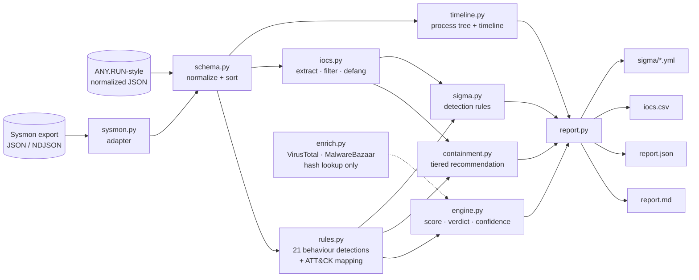

<div align="center">

# 🧪 SandboxScribe

**Turn raw sandbox telemetry into a SOC-grade malware report**
*Process tree · Behaviour timeline · MITRE ATT&CK · IOCs · Sigma rules · Containment recommendation*

> *The report is the deliverable. The sandbox is just the tool.*

🇬🇧 English · [🇫🇷 Français](README.fr.md)


[](https://github.com/NikoRNK/sandboxscribe/actions)

</div>

---

## Table of contents

1. [Why this project](#why-this-project)
2. [From detonation to deliverable](#from-detonation-to-deliverable)
3. [Features](#features)
4. [Architecture](#architecture)
5. [Quick start](#quick-start)
6. [Usage](#usage)
7. [Input formats](#input-formats)
8. [Example output](#example-output)
9. [Detection rules & scoring](#detection-rules--scoring)
10. [MITRE ATT&CK coverage](#mitre-attck-coverage)
11. [Sigma rule generation](#sigma-rule-generation)
12. [Use it as a library](#use-it-as-a-library)
13. [Detonating safely](#detonating-safely)
14. [Project layout](#project-layout)
15. [Tests](#tests)
16. [Design decisions & limitations](#design-decisions--limitations)
17. [Roadmap](#roadmap)
18. [Responsible use](#responsible-use)
19. [Author](#author) · [License](#license)

---

## Why this project

Every SOC receives suspicious attachments. Detonating one in a sandbox is the
easy part. What separates an analyst from a button-pusher is the **write-up**:
a clear behaviour timeline, the indicators the blue team can block, and a
containment recommendation a manager can approve in two minutes.

**SandboxScribe automates that write-up.** It reads the telemetry of a detonation
(from ANY.RUN-style tools, or from an isolated VM running Sysmon) and produces:

* a **verdict** with a confidence level, justified rule by rule,
* a **process tree** and a **behaviour timeline** in plain English,
* every behaviour mapped to **MITRE ATT&CK**,
* **defanged IOCs** (hashes, domains, IPs, URLs, mutexes, persistence keys, dropped files) with OS noise filtered out,
* **Sigma detection rules** generated from what the sample actually did,
* a **tiered containment recommendation** derived from the observed behaviour.

> **SandboxScribe never executes, opens or downloads a sample.** It only analyses
> telemetry that was already collected. This repository contains no malware.

## From detonation to deliverable

| Step | What a good analyst does | Where it happens |
|------|--------------------------|------------------|
| **Detonate safely** | Take a research sample (e.g. from MalwareBazaar) | You, in a lab — see [`docs/SAFE_LAB.md`](docs/SAFE_LAB.md) |
| | Run it in ANY.RUN or an **isolated VM only** | You (hosted sandbox or snapshot-restored VM) |
| | Watch **processes, files, network** | Sandbox / Sysmon produce the telemetry |
| **Write it up** | **Behaviour timeline** | `timeline.py` — process tree + chronological events |
| | **IOCs, hashes, domains, IPs** | `iocs.py` — deduplicated, defanged, noise-filtered |
| | **A containment recommendation** | `containment.py` — tiered, specific to what was observed |
| *(bonus)* | Make sure it is caught next time | `sigma.py` — Sigma rules |

## Features

- 🧬 **21 explainable behaviour detections** mapped to 23 ATT&CK techniques: Office→shell chains, encoded PowerShell, download cradles, Run-key / scheduled-task / service persistence, Defender tampering, process injection, LSASS access, browser-credential theft, shadow-copy deletion, mass encryption, C2 beaconing (interval + jitter analysis), DGA-like domains, large uploads, self-deletion, sandbox-evasion delays…
- 🌳 **Process tree** reconstructed from `pid`/`ppid`
- 🕒 **Behaviour timeline** — every event behind a detection is always shown
- 🎯 **IOC extraction** with OS/vendor noise filtering (Windows Update, certificate checks…) and defanging
- 🛡️ **Containment recommendation** in four tiers: *Immediate · Eradicate · Hunt · Recover & communicate* — each line exists only if the matching behaviour was observed
- 📜 **Sigma rule generator** (process creation, DNS, network, registry, file events)
- 🔌 **Sysmon adapter** — JSON array or NDJSON, auto-detected
- 🌐 **Optional hash intel** — VirusTotal v3 and MalwareBazaar (lookup only, cached, never uploads)
- 🧾 **Outputs** — Markdown report, JSON, IOC CSV, Sigma YAML
- 🧱 **Zero dependencies** — pure standard library
- 🤖 **SOAR-friendly** — exit code `2` on `MALICIOUS`

## Architecture



## Quick start

```bash
git clone https://github.com/NikoRNK/sandboxscribe.git
cd sandboxscribe
pip install -e .          # no runtime dependencies

sandboxscribe report samples/invoice_dropper_report.json \
    --no-intel --out report.md --iocs iocs.csv --sigma-dir sigma/
```

Requires **Python 3.9+**. Works on Linux, macOS and Windows.

## Usage

```text
sandboxscribe report <input> [--out report.md] [--json result.json] [--iocs iocs.csv]
                             [--sigma-dir DIR] [--author NAME] [--no-intel]
                             [--vt-key KEY] [--mb-key KEY] [--cache DIR]
                             [--sample-name NAME] [--sample-sha256 SHA]
sandboxscribe tree   <input>
sandboxscribe --version
```

| Option | Description |
|--------|-------------|
| `--out / --json / --iocs` | Markdown report, full JSON result, IOC CSV |
| `--sigma-dir DIR` | Write the generated Sigma rules into this folder |
| `--author NAME` | `author:` field of the Sigma rules (default `SandboxScribe`) |
| `--no-intel` | Never contact VirusTotal / MalwareBazaar |
| `--vt-key` / `--mb-key` | API keys; default to `$VT_API_KEY` / `$MB_AUTH_KEY` |
| `--sample-name/--sample-sha256` | Identify the sample when the input is a Sysmon export |

**Exit codes:** `0` = suspicious / clean · `2` = malicious · `1` = error.

```bash
# Native normalized report (ANY.RUN-style export you converted, or hand-written)
sandboxscribe report detonation.json --out report.md

# Isolated VM + Sysmon export (auto-detected)
sandboxscribe report sysmon.ndjson --sample-name dropper.js --sample-sha256 <sha256> \
    --out report.md --sigma-dir sigma/

# Just the process tree
sandboxscribe tree detonation.json

# With hash intel
export VT_API_KEY=… MB_AUTH_KEY=…
sandboxscribe report detonation.json --out report.md
```

## Input formats

1. **Normalized JSON** — one small, documented schema any sandbox can be reduced to
   (14 event types). Reference: [`docs/SCHEMA.md`](docs/SCHEMA.md).
2. **Sysmon export** — events 1, 3, 8, 10, 11, 13, 22, 23, as a JSON array or
   NDJSON, converted automatically. The PowerShell one-liner to produce it is in
   [`docs/SAFE_LAB.md`](docs/SAFE_LAB.md).

## Example output

All numbers below come from the bundled **synthetic** sample (a fictional macro
document that drops a fake `svchost32.exe`; no real malware is involved):

```text
$ sandboxscribe report samples/invoice_dropper_report.json --no-intel --out report.md --sigma-dir sigma/
[MALICIOUS] score=100/100 confidence=HIGH detections=15 iocs=12 sigma_rules=5
```

**Process tree**

```text
winword.exe (pid 4120)  "WINWORD.EXE" "C:\Users\analyst\Desktop\Invoice_2025-10.docm"
└─ cmd.exe (pid 5208)  cmd.exe /c powershell -nop -w hidden -enc VwByAGkAdABl…
   └─ powershell.exe (pid 5320)  powershell -nop -w hidden -enc VwByAGkAdABl…
      └─ svchost32.exe (pid 5600)  C:\Users\analyst\AppData\Roaming\Microsoft\Windows\svchost32.exe
         ├─ powershell.exe (pid 5730)  powershell -c Add-MpPreference -ExclusionPath …
         ├─ schtasks.exe (pid 5710)  schtasks /create /tn "WinUpdHelper" /tr "…svchost32.exe" /sc onlogon
         ├─ whoami.exe · systeminfo.exe · ipconfig.exe
         └─ cmd.exe (pid 5800)  cmd.exe /c ping -n 30 127.0.0.1 > nul & del "…Invoice_2025-10.docm"
```

**What the sample does** (top findings, chronological):

> 2. **Persistence** — Autostart persistence (Run key). `…\CurrentVersion\Run [WindowsUpdateHelper] = …\svchost32.exe`
> 3. **Defense Evasion** — Security tooling disabled or excluded. `Add-MpPreference -ExclusionPath …`
> 4. **Defense Evasion** — Code injected into another process. `pid 5600 -> explorer.exe`
> 5. **Persistence** — Scheduled task created for persistence.
> 6. **Credential Access** — Browser credential store read by a non-browser process.
> 7. **Command and Control** — Regular, periodic callbacks to one host. `203.0.113.45: 6 requests, every ~27s (jitter 23%)`

**Containment recommendation** (excerpt — note how specific it is):

> **Eradicate:** Delete registry persistence `HKCU\…\Run` value `WindowsUpdateHelper` (points to `…\svchost32.exe`) ·
> Delete the scheduled task(s) created by the sample · Remove dropped file `…\svchost32.exe` (sha256 `9a496227eda4…`) ·
> Remove added Defender exclusions · Memory-image the injected host before reboot.

**Defanged IOCs** (OS noise such as `settings-win.data.microsoft.com` is filtered out):

| Type | Value |
|---|---|
| sha256 | `2ff95d39ccb5…` (sample) · `9a496227eda4…` (dropped `svchost32.exe`) |
| domain | `update-cdn-7x2k9qv4mz[.]example` |
| ip | `203[.]0[.]113[.]45` |
| url | `hxxp://update-cdn-7x2k9qv4mz[.]example/stage2[.]bin` |
| mutex | `Global\SynthMutex-7Q2K` |
| registry | `HKCU\…\Run [WindowsUpdateHelper]` |

Full outputs in [`examples/`](examples/):
[`report_invoice_dropper.md`](examples/report_invoice_dropper.md) ·
[`report_invoice_dropper.json`](examples/report_invoice_dropper.json) ·
[`iocs_invoice_dropper.csv`](examples/iocs_invoice_dropper.csv) ·
[`sigma/`](examples/sigma/) ·
[`report_benign_installer.md`](examples/report_benign_installer.md) (the clean case) ·
[`report_sysmon_script_dropper.md`](examples/report_sysmon_script_dropper.md) (Sysmon input).

## Detection rules & scoring

Score = sum of weights, capped at 100. Every detection stores the **exact events** that triggered it.

| Tactic | Rule | Weight | ATT&CK |
|--------|------|:------:|--------|
| Execution | Office app spawns a command interpreter | 25 | T1204.002 |
| | PowerShell with stealth flags (`-nop`, hidden window, bypass) | 15 | T1059.001 |
| | Download cradle (`DownloadString`, `certutil -urlcache`, BITS…) | 20 | T1105 |
| Persistence | Run key / Startup folder | 25 | T1547.001 |
| | Scheduled task | 20 | T1053.005 |
| | Windows service | 20 | T1543.003 |
| Defense evasion | Encoded PowerShell | 10 | T1027 |
| | LOLBin proxy execution (`mshta`, `regsvr32`, `rundll32`) | 15 | T1218 |
| | Defender disabled / excluded | 25 | T1562.001 |
| | Process injection | 25 | T1055 |
| | Self-deletion of the sample | 10 | T1070.004 |
| | Time-based evasion (`ping -n 30`, `timeout /t`) | 10 | T1497.003 |
| Credential access | LSASS access / `comsvcs MiniDump` | 35 | T1003.001 |
| | Browser credential store read by non-browser | 30 | T1555.003 |
| Discovery | `whoami` / `systeminfo` / `ipconfig /all` cluster | 10 | T1033 / T1082 / T1016 |
| C2 | Periodic beaconing (interval mean + jitter ≤ 35 %) | 25 | T1071.001 |
| | DGA-like high-entropy domain | 15 | T1568.002 |
| | Unusual outbound port | 10 | T1571 |
| Exfiltration | Large HTTP POST (≥ 100 kB) | 20 | T1041 |
| Impact | Shadow copies / backups destroyed | 35 | T1490 |
| | ≥ 20 files renamed to one new extension | 40 | T1486 |

| Score | Verdict |
|-------|---------|
| ≥ 60, or confirmed by intel (≥ 10 VT engines / MalwareBazaar signature) | 🔴 `MALICIOUS` |
| 25 – 59 | 🟠 `SUSPICIOUS` |
| < 25 | 🟢 `NO MALICIOUS BEHAVIOUR OBSERVED` |

The clean verdict is deliberately **not** called "benign": a sandbox only reports
what it saw, and evasive samples can stay quiet. The report states this.

## MITRE ATT&CK coverage

23 techniques across 8 tactics (Execution, Persistence, Defense Evasion,
Credential Access, Discovery, Command and Control, Exfiltration, Impact). The
report prints a kill-chain strip showing which tactics were observed.

## Sigma rule generation

One detonation becomes durable detections. Example generated from the sample:

```yaml
title: Registry Persistence Value Set by Analysed Sample
id: 28116603-be8c-54c4-a07a-3a27ad6b4920
status: experimental
description: Autostart registry value created during detonation.
author: SandboxScribe
tags:
    - attack.persistence
    - attack.t1547.001
logsource:
    category: registry_set
    product: windows
detection:
    selection:
        TargetObject|endswith:
            - '\Run\WindowsUpdateHelper'
    condition: selection
level: high
```

Rules produced when the behaviour exists: **Office→shell**, **DNS to C2**,
**network to C2 IP**, **registry persistence**, **dropped executable**. They are
narrow starters built from observed values: generalise and back-test before production.

## Use it as a library

```python
from sandboxscribe.schema import load_report
from sandboxscribe.engine import analyze
from sandboxscribe.report import render_markdown

result = analyze(load_report("detonation.json"))
print(result["verdict"], result["score"], result["confidence"])
for d in result["detections"]:
    print(d["tactic"], d["technique"], d["title"])
open("report.md", "w").write(render_markdown(result))
```

## Detonating safely

Read [`docs/SAFE_LAB.md`](docs/SAFE_LAB.md): isolated VM checklist (snapshot, no
shared folders, host-only network with a fake internet), hosted-sandbox advice,
the Sysmon JSON export snippet, and the rule that matters most: **never commit
malware to a repository**. The `.gitignore` blocks `.exe`, `.dll` and `.zip`.

## Project layout

```text
sandboxscribe/
├── sandboxscribe/
│   ├── schema.py        # normalized schema + loader
│   ├── sysmon.py        # Sysmon JSON / NDJSON adapter
│   ├── rules.py         # 21 behaviour detections + ATT&CK mapping
│   ├── iocs.py          # extraction, noise filter, defanging
│   ├── timeline.py      # process tree + behaviour timeline
│   ├── containment.py   # tiered containment recommendation
│   ├── sigma.py         # Sigma rule generator
│   ├── enrich.py        # VirusTotal / MalwareBazaar hash lookup
│   ├── engine.py        # score, verdict, confidence, orchestration
│   ├── report.py        # Markdown / JSON / CSV
│   └── cli.py           # `sandboxscribe report | tree`
├── samples/             # SYNTHETIC telemetry only (malicious, benign, Sysmon)
├── examples/            # generated reports, IOC CSV, Sigma rules
├── docs/                # SCHEMA, SAFE_LAB, METHODOLOGY
├── tests/               # 19 tests
└── .github/workflows/   # CI on Python 3.9, 3.11, 3.12
```

## Tests

```bash
pip install -e ".[dev]"
pytest -q
```

19 tests cover every rule family (true positives **and** negatives such as a normal
parent process, irregular traffic, OS-noise domains), the Sysmon adapter, IOC
filtering and defanging, containment specificity (no ransomware advice unless
observed), Sigma generation and the three renderers.

## Design decisions & limitations

* **Telemetry in, report out.** The tool never runs samples, so it is safe to use anywhere.
* **Explainable heuristics.** Each finding links back to raw events; nothing is a black box.
* **Evidence-driven advice.** Containment lines are generated from observed behaviour only.
* **Limitations:** quality depends on telemetry (a default Sysmon config produces no file-read events, so the browser-credential rule needs a sandbox with file-access tracing);
  VM-aware malware can evade the sandbox before SandboxScribe sees anything;
  Sigma output is a starting point. The VirusTotal / MalwareBazaar clients follow the public APIs and are off by default (`--no-intel`); the test suite runs fully offline.

## Roadmap

- [ ] Native adapters for CAPE and ANY.RUN report exports
- [ ] YARA rule generation from dropped-file strings
- [ ] Evtx parsing (no PowerShell export step)
- [ ] STIX 2.1 / MISP export
- [ ] HTML report with an interactive process tree
- [ ] Network-capture (PCAP / HAR) enrichment for C2 protocol details

## Responsible use

A **defensive** tool for analysts. Only handle samples you are authorised to handle,
detonate them only in an isolated environment, never upload confidential files to
public services, and never publish live malware.

## Author

**NikoRNK** — aspiring SOC analyst · [github.com/NikoRNK](https://github.com/NikoRNK)

See also: [PhishScope](https://github.com/NikoRNK/phishscope) — phishing email investigation toolkit.

## License

[MIT](LICENSE) © 2026 NikoRNK
